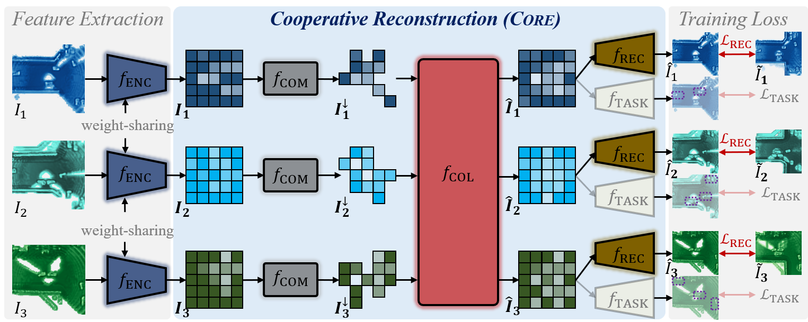

# CORE: Cooperative Reconstruction for Multi-Agent Perception



> [**CORE: Cooperative Reconstruction for Multi-Agent Perception**](https://arxiv.org/abs/2307.11514),            
> Binglu Wang, Lei Zhang, Zhaozhong Wang, Yongqiang Zhao, and [Tianfei Zhou](https://www.tfzhou.com/) <br>
> *ICCV 2023 ([arXiv 2307.11514](https://arxiv.org/abs/2307.11514))*

## Abstract

This paper presents CORE, a conceptually simple, effective and communication-efficient model for multi-agent cooperative perception.  It addresses the task from a novel perspective of cooperative reconstruction, based on two key insights: 1) cooperating agents together provide a more holistic observation of the environment, and 2) the holistic observation can serve as valuable supervision to explicitly guide the model  learning how to reconstruct the ideal observation based on collaboration.  CORE instantiates the idea with three major components: a compressor for each agent to create more compact feature representation for  efficient broadcasting, a lightweight attentive collaboration component for cross-agent message aggregation, and a reconstruction module to  reconstruct the observation based on aggregated feature representations. This learning-to-reconstruct idea is task-agnostic, and offers clear and reasonable supervision to inspire more effective collaboration, eventually  promoting perception tasks. We validate CORE on two large-scale multi-agent percetion dataset, OPV2V and V2X-Sim, in  two tasks, i.e., 3D object detection and semantic segmentation. Results demonstrate that CORE achieves state-of-the-art performance, and is more communication-efficient.

## Installation

CORE uses Python 3.7, PyTorch 1.12.1 and CUDA 11.3. To set up the GPU environment, clone the repository and create a Conda environment for it.

```bash
git clone https://github.com/zllxot/CORE.git
cd CORE
conda create -n core python=3.7
conda activate core
conda install -c pytorch pytorch=1.12.1 torchvision=0.13.1 cudatoolkit=11.3
```

From the repository root, install the dependencies (including the CUDA 11.3 build of spconv), register the local `opencood` package, and compile the extension used to compute bounding-box overlaps. The last command requires a C compiler.

```bash
python -m pip install -r requirements.txt
python -m pip install --no-deps --no-build-isolation -e .
python opencood/utils/setup.py build_ext --inplace
```

## Dataset
Our experiments are conducted on the OPV2V dataset.  You can learn more about this dataset by visiting the [website](https://mobility-lab.seas.ucla.edu/opv2v/).

## Quick Start

### Choose a configuration

Pick a backbone and task from the table. In that YAML file, set `root_dir`, `validate_dir`, and `test_dir` to your OPV2V training, validation, and test directories. For BEV segmentation, include `*_bev_dynamic.png`, `*_bev_static.png`, and `*_bev_lane.png` alongside each ego vehicle's point cloud.

| Backbone | 3D object detection | BEV semantic segmentation |
| --- | --- | --- |
| PointPillar | [point_pillar_core_det.yaml](opencood/hypes_yaml/point_pillar_core_det.yaml) | [point_pillar_core_seg.yaml](opencood/hypes_yaml/point_pillar_core_seg.yaml) |
| VoxelNet | [voxelnet_core_det.yaml](opencood/hypes_yaml/voxelnet_core_det.yaml) | [voxelnet_core_seg.yaml](opencood/hypes_yaml/voxelnet_core_seg.yaml) |

### Train

For example, to train the PointPillar detector on one GPU, run the following from the repository root.

```bash
CONFIG=opencood/hypes_yaml/point_pillar_core_det.yaml
python opencood/tools/train.py --hypes_yaml "$CONFIG"
```

For eight GPUs on one machine, use the same configuration with PyTorch's distributed launcher. The supplied configurations use a batch size of one per GPU, giving an effective batch size of eight.

```bash
python -m torch.distributed.run --standalone --nproc_per_node=8 opencood/tools/train.py --hypes_yaml "$CONFIG"
```

Add `--half` to either training command to enable mixed precision on CUDA. The trainer prints the run directory under `opencood/logs/`, where it saves `config.yaml` and the epoch checkpoints (`net_epoch*.pth`). To continue training from the latest saved weights, add `--model_dir /path/to/run` to the training command. The trainer then reads the configuration from that directory and initializes a fresh optimizer.

### Evaluate a checkpoint

Set `RUN_DIR` to the directory printed during training. The evaluator reads its configuration, loads the latest saved epoch, and evaluates the split named in `test_dir`.

```bash
RUN_DIR="opencood/logs/YOUR_RUN_DIRECTORY"
python opencood/tools/inference.py --model_dir "$RUN_DIR"
```

To evaluate another OPV2V split, append `--test_dir /path/to/split` to the command. Look in the run directory for the results. Detection runs write AP at IoU thresholds 0.3, 0.5, and 0.7 to `eval.yaml`. Segmentation runs write vehicle, road, and lane IoU and their mean to `eval_segmentation.yaml`.

## Acknowledgment
Gratitude to the creators and contributors of the following open-source cooperative perception works, codebases, and datasets, which played a crucial role in shaping this project:
- [OpenCOOD](https://github.com/DerrickXuNu/OpenCOOD)
- [OPV2V](https://mobility-lab.seas.ucla.edu/opv2v/)
- [CoPerception](https://github.com/coperception/coperception/tree/dd8fbb660300ee763e0bac870f63fc4987440a35)
- [V2X-Sim](https://ai4ce.github.io/V2X-Sim)
- [DiscoNet](https://github.com/ai4ce/DiscoNet)
- [CoBEVT](https://github.com/DerrickXuNu/CoBEVT)
